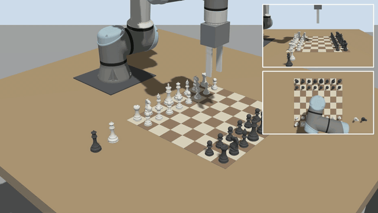
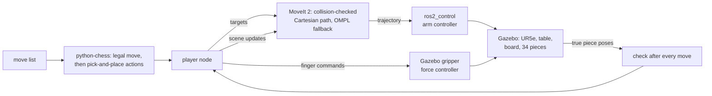
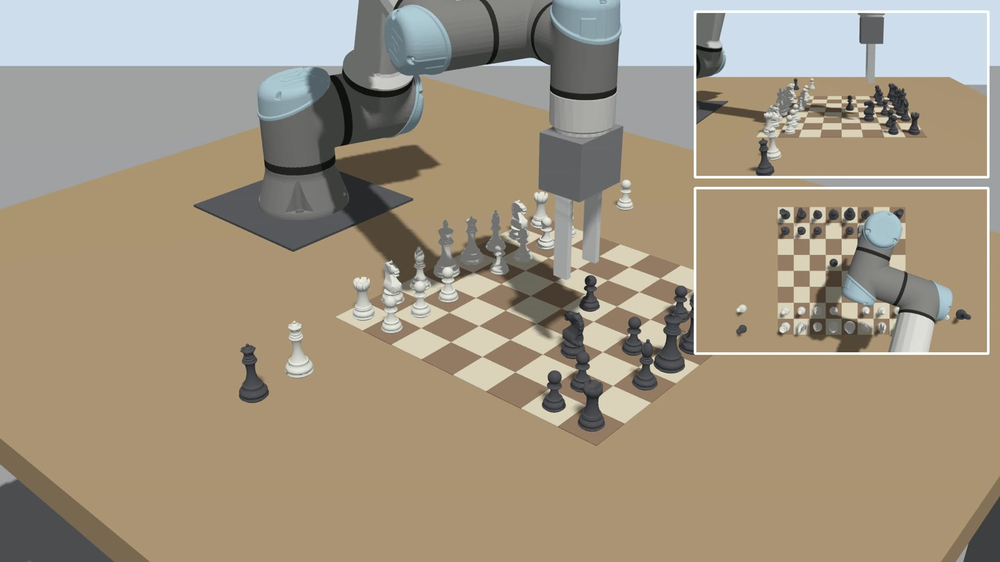

# chess_arm_demo



A UR5e plays chess in Gazebo. A move list chooses each move, python-chess checks it is legal, MoveIt 2 plans it,
and the arm moves the piece with a two-finger gripper and a physics grasp. After every move the simulator's true piece
poses are compared with the expected board.

Built in about a day, from open-source parts, and unpolished. It runs the stack end to end: Gazebo, `ros2_control`,
MoveIt 2 and a ROS 2 node that plays the game.

**Demo:** [`docs/demo_6x.mp4`](docs/demo_6x.mp4) (41 s time-lapse) and [`docs/demo_full.mp4`](docs/demo_full.mp4)
(4 min 6 s, real simulation speed), both 1920x1080, from the world's three cameras. The result file of that run is
[`docs/demo_result.json`](docs/demo_result.json).

| 16-move game: en passant, kingside and queenside castling, two captures | |
|---|---|
| moves that passed the check against Gazebo's true piece poses | 16 of 16 |
| largest placement error | 0.1 mm |
| retries after a controller abort | 0 |
| moves that needed the OMPL fallback | 0 |
| time in planning services, whole game | 1.3 s |

## How it works



- **Planning (`moveit_arm.py`).** Each move is a collision-checked straight path from `/compute_cartesian_path`, run
  by `/execute_trajectory` on the arm's `joint_trajectory_controller`. If a straight path is blocked, the same target goes
  to OMPL through `/move_action` (it did not trigger in the demo game). A tolerance abort re-plans from where the arm
  stopped, up to twice.
- **Planning scene.** The table, the board and every piece are collision objects. A carried piece is attached to the
  hand and put back in the world, at its square, when the gripper opens.
- **Gripper (`urdf/chess_ur.urdf.xacro`).** Two prismatic fingers on Gazebo's joint position controller, a force PID with a
  20 N cap. The finger readings decide whether a piece is held (finger sum matches the piece width), with one retry.
  MoveIt plans with the fingers open and rigid.
- **Game layer (`game.py`, no ROS).** Turns a move into pick-and-place actions: captures, en passant, both castles, queen
  promotion (a spare queen per colour).
- **Verification (`player.py`, `poses.py`).** A move passes if every moved piece ends within 12 mm of its square centre,
  all pieces stand, and no other piece moved more than 15 mm. Ground truth is read from Gazebo and used only to check,
  never to plan.
- **World (`worlds/chess.sdf`).** Floor, table with legs, board, 34 pieces (32 and a spare queen per colour) and three
  cameras (overview 1920x1080, side and top 1280x720; topics `/cam/overview`, `/cam/side`, `/cam/top`). The robot is spawned on the table by `launch/sim.launch.py`.



## Run

Needs ROS 2 Jazzy with Gazebo Harmonic. Install the rest once:

```bash
rosdep install --from-paths . --ignore-src -y     # ROS side: UR packages, MoveIt 2, ros_gz, ros2_control (run from your workspace src/)
pip install -r requirements.txt                    # python-chess (add --break-system-packages on Ubuntu 24.04 if pip refuses)
```

```bash
colcon build --symlink-install --packages-select chess_arm_demo
source install/setup.bash
ros2 launch chess_arm_demo sim.launch.py           # terminal 1: Gazebo with its window (add gui:=false to run headless)
ros2 launch chess_arm_demo moveit.launch.py        # terminal 2: MoveIt 2 (wait for "You can start planning now!")
ros2 run chess_arm_demo chess_player               # plays the demo game: e2e4 d7d5 e4e5 f7f5 e5f6 g8f6 g1f3 c8g4 ...
ros2 run chess_arm_demo chess_player --moves "e2e4 e7e5 g1f3"      # or any list of legal UCI moves
```

The window is a viewer only: closing it does not stop the simulation, and `gui:=false` skips it.
The player writes a log line per move and a summary to `/tmp/chess_result.json`. Restart both launches before a
new game: a crashed run leaves a piece attached in MoveIt's planning scene.
Tests (game logic, world file, tool pose): `python3 -m pytest test`.

## Limits

- The simulation gives the planner the true piece positions. There is no perception: no camera board detection and no
  human-move detection.
- Only queen promotion is implemented. The final game does not include it, so it has not run with MoveIt.
- The planning scene comes from the game state, not from sensors. Pieces are cylinders in the scene.
- The world file is the starting position only.
- Gazebo ran at about 0.6 of real time while recording at 1080p. The video places frames by simulation time, so the arm moves at its true speed.
- Simulation only. No hardware.

## Credits

- Staunton chess pieces by DrSteele, CC BY ([Thingiverse](https://www.thingiverse.com/thing:5470356)). Changes
  (units, origin, knight turned, 12,000 triangles each) in `assets/pieces/ATTRIBUTION.md`.
- UR5e model and `ros2_control` setup: the Universal Robots ROS 2 packages. python-chess for the rules.
- Licence: Apache-2.0.
